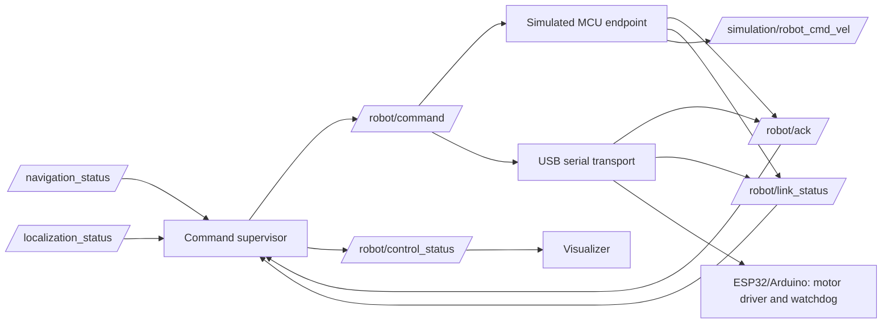
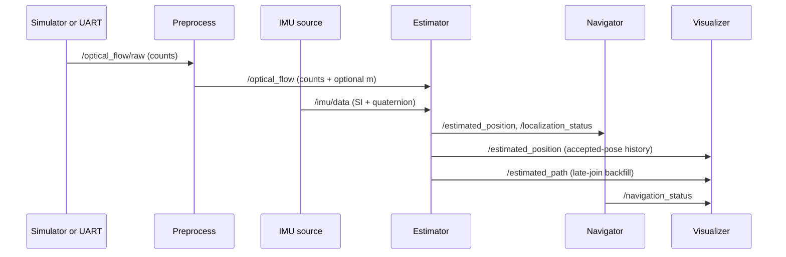

# Architecture and interfaces

Two ROS packages are used: `gps_nav_interfaces` for wire contracts and `gps_nav` for Python nodes. The same `/optical_flow/raw` message comes from one selected source. `OpticalFlow` has a `std_msgs/Header`, signed raw counts, raw quality 0–255, optional calibrated displacement in metres, a `metric_valid` gate, and a source label. Raw values are preserved after preprocessing. `sensor_msgs/Imu` carries orientation and inertial data. The estimator does not use acceleration for position. Robot control is a separate downstream graph; the estimator and navigator never publish directly to a serial port.

The simulated MCU and real USB transport are mutually exclusive launch choices. The supervisor has no serial dependency and applies the same localization, heading, calibration, freshness, arrival, and acknowledgement gates in both modes. The simulated MCU drives the interactive simulation plant through `/simulation/robot_cmd_vel`, selected by the launch's `cmd_vel_topic` parameter. Ordinary interactive demos keep `/simulation/cmd_vel`, so a command from one mode cannot move the other's plant merely by sharing a ROS domain. Ground truth is never published to the estimator. The real transport has an independent default-off motor-output gate. No physical motor backend has been identified or validated.

Topics: `/navigation_goal` is `geometry_msgs/PointStamped` in `map_enu`; `/estimated_position` is `PoseStamped`; `/estimated_path` is `nav_msgs/Path`; `/estimated_odometry` is `nav_msgs/Odometry` with unknown/large covariance; `/estimated_velocity` is `geometry_msgs/TwistStamped` in ENU when interval-based derivation is enabled; `/localization_status` and `/navigation_status` are custom messages. `/sensor_status/hereflow` is a readable diagnostics string. `/simulation/ground_truth` and `/simulation/done` exist only in simulation. `/session_reset` is a reset event.

Services: `/set_session` sets a new origin and destination and resets the estimator. `/set_destination` changes the goal without moving the origin or position. The `terminal_waypoint` CLI calls those services. Arrival requires three fresh valid pose updates within 0.25 m by default. Repeated goal publications do not reset arrival. When data becomes stale, position is preserved but validity is withdrawn.

The real launch excludes simulator. The simulation launch excludes UART. The real IMU source is an external future adapter that must publish valid orientation and covariance on `/imu/data`; no physical model was identified during this work.

`hereflow_diagnostic` is a standalone command with no ROS node or navigation subscriptions. It and `hereflow` share `HereFlowReader` (port lifecycle, packet parser, health counters). Only one process should open the serial port at a time. The reader clears partial frames on disconnect so two different connection sessions cannot form a fabricated packet. The serial health topic reports raw connection/packet statistics and staleness; it does not certify calibrated localization.

At the estimator's ROS boundary, IMU and flow timestamps must be no older than `stale_s` at receipt and no farther than `future_stamp_tolerance_s` into the future. Delayed flow is rejected before it can change position. A rejected IMU timestamp invalidates heading. These checks assume publisher and estimator clocks share the ROS time base; a future physical IMU driver must align its timestamps accordingly.

For finite simulation, the simulator assigns one `node.get_clock().now()` stamp per sample to truth, IMU and optical flow. Preprocessing preserves the flow stamp; the estimator compares it to its ROS clock using integer nanoseconds. These graphs use the default system ROS clock (`use_sim_time=false`). The `demo` command selects a private ROS domain unless `--domain-id` is supplied, so another graph's absolute topic names cannot mix with its measurements. The finite demo renders its PNG after callbacks and verifies the final truth stamp also appeared on `/estimated_position`. Interactive launch graphs still render periodically in a separate visualizer process; run concurrent graphs with different `ROS_DOMAIN_ID` values.

The finite-demo monitor and visualizer use the same `TrajectoryHistory` implementation keyed by pose timestamp. The visualizer takes accepted estimated poses from `/estimated_position`; `/estimated_path` snapshots only merge missing timestamps. Session reset clears the history and arrival latch; changing only the destination preserves history and starts a new arrival check. Rendering splits lines across long sensor gaps, uses equal ENU axis scaling, and includes the start, goal, all accepted poses, and final pose in its limits. Arrival remains latched in the display after sensors become stale for the same destination; current IMU and localization health are shown separately. Ground truth never enters this history.

## Live simulation and goal-directed mode

The simulator's `mode` parameter selects `goal`, `scripted`, or `interactive`; goal is the default. A non-default scripted `path` without `mode=scripted` is rejected. Scripted mode uses the unchanged `PathSimulator` segments for regression routes. Goal mode uses `GoalSimulator`: each fixed `dt` step recalculates bearing to its configured local ENU goal, rotates in place at no more than `turn_rate_rad_s`, then advances at no more than `speed_m_s`. `SimulatorNode` observes `/navigation_status` and ends goal mode only after the navigator publishes `destination_reached=true`; otherwise it continues stationary at the geometric goal until `max_duration_s` produces a timeout. Interactive mode steps the same physical model continuously from `/simulation/cmd_vel`; `/set_destination` updates guidance and the graph without resetting estimated history. It runs until stopped or a configured positive duration expires. The same raw optical-flow and IMU publishers feed the production preprocessing, estimator, and navigator in all modes. The model has no obstacle map, collision check, or claim of global optimality.

For `demo --show`, the Matplotlib figure and event loop run on the main thread. A **single** `SingleThreadedExecutor` spins all ROS nodes on one background thread. ROS callbacks only update node state and the ordered trajectory history; they never draw or save a figure. The visualizer holds a short state lock while copying its current pose, goal, status, and history. It releases the lock before all Matplotlib calls, so rendering cannot delay sensor callbacks. The demo draws an initial frame before starting the executor, then redraws approximately every 0.1 s while simulation runs. PNG capture during the run is optional and occurs on the GUI thread. After finite `/simulation/done`, the executor drains for three seconds, then stops; the final figure and JSON use identical pose histories. Interactive mode can run indefinitely and records a final plot and metrics when stopped. The window remains responsive until the user closes it. A close event shuts down ROS and joins the executor thread. Headless demos use the original single-threaded spin loop and render only the final PNG.
